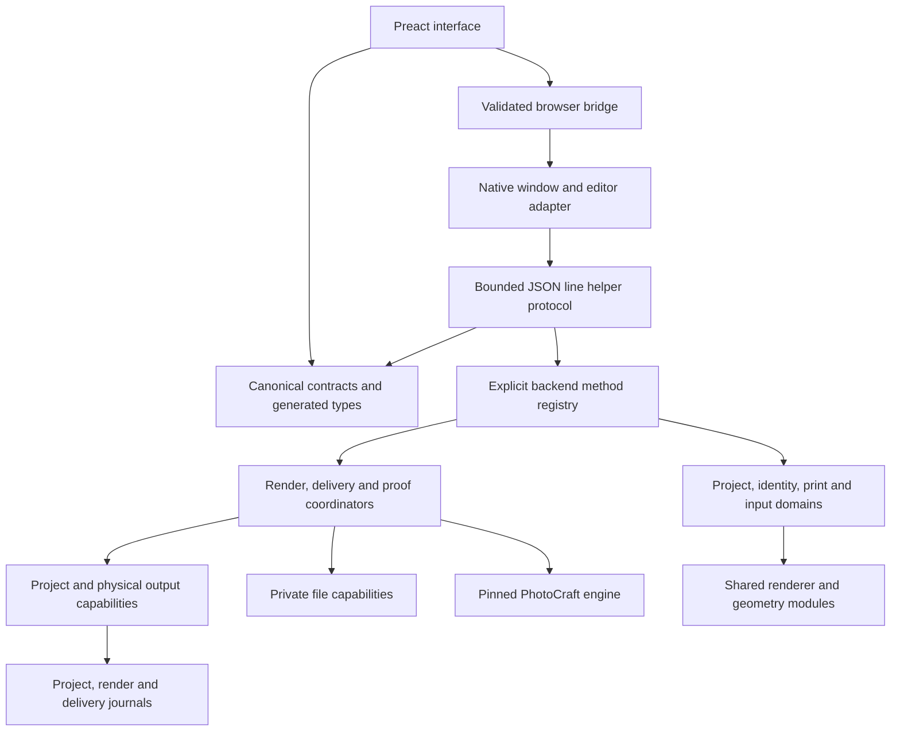

# Album Studio architecture

The architecture target is strictly above 9.5/10 using the existing ten equally weighted
criteria. A complete criterion earns 10 points, a partial criterion 5, and an unverified one
0. With this rubric, exceeding 9.5 requires all ten criteria to be complete. This document
describes implemented boundaries and remaining acceptance work; it does not certify that target.

## Components and dependency direction

`native/contracts/contract-manifest.json` inventories backend and shell methods and events.
`album-studio.schema.json` defines request, result, event, error and persisted-project shapes.
`runtime.js` validates values in Node and in the browser bundle; `types.ts` is generated from
the same definitions. Native shell methods are inventoried, but the current Rust adapter's
opaque JSON values and string errors remain an acceptance gap. An inventory does not establish
typed native execution.

The interface's `call()` infers parameters and results from the method name. It validates
outbound requests and the matching method's reply, bounds pending requests/timeouts, clears
failed posts, and retains structured recovery information in `RemoteError.details`. Events
are validated before workflow listeners run. Invalid payloads surface through protocol-error
listeners; a failed listener does not prevent other listeners from running.

The helper's dispatcher validates before invoking a registered method and validates returned
results. A result-format failure after execution tells the caller to verify state before
retrying. Domain errors preserve commit, restoration and recovery paths across the protocol.
Input framing rejects oversized lines and invalid UTF-8, coalesces fragmented input into
bounded slabs, and resynchronizes at a newline. Output backpressure and native transport
execution require their own verification; request byte limits alone do not establish them.

## State and ownership

The project file is the persistent source of album edits. A canonical project lease serializes
cooperative writers. A physical output namespace capability additionally protects shared
render/proof/delivery locations. A job keeps these capabilities through preparation,
publication, recovery and release. Journal protocols distinguish preparation, pending rollback,
durable commit and retained recovery history. Failed shutdown or lease release is a job-level
finishing error; it does not turn an already committed sheet into a failed sheet.

Private decoder work uses a capability recording generated filenames, file identity, mode and
content digest. Complete nonempty stages retire through an exclusive atomic move. Node cannot
conditionally unlink an exact inode, so digest-check followed by unlink is insufficient when
an external process can replace the name. Unknown or modified work is retained and reported.
An explicit transfer gives the delivery journal ownership of its stage; the caller stops
cleaning it afterward. Source-copy stages remain separate from journal-owned stages.

Retention checks are conservative per-parent refusal policies, not distributed reservations
against every native process. They currently default to 8 GiB, 256 stages and a 256 MiB free-space
reserve. No existing history is automatically pruned. Safe permanent ownership, producer-wide
coordination and an approved reclamation workflow remain required. Nonempty loose caches with
unverified ownership are preserved; the Storage action can therefore refuse a clear request.

Asset registry IDs remain persistent when source folders are reordered or relinked. New physical
root aliases can share one identity; separately saved identities with different edits require
explicit reconciliation. Historical aliases must stay reserved after their sources disappear.
Alias migration tests and final independent review are required before certifying this boundary.

## Project compatibility and business rules

`project_domain.js` validates before applying explicit legacy normalizations. Supported legacy
missing/zero versions and decimal digit strings normalize to version 1; future versions are
refused. Active spread counts must be finite bounded integers. Existing pages outside a declared
count are refused rather than discarded. Known fields are checked while unknown extension
fields are preserved. Validation does not clone the supplied model: the existing atomic-save
preparation path intentionally observes its explicit migrations.

Bounds include 10,000 spreads, 1,000 operations per request, 1,000 photo references per spread,
one million aggregate references and bounded identity/edit maps. Creation, mutation, reopening
and job/output acquisition use the domain boundary. These are safety limits, not evidence that
the interface or engine performs acceptably at those maximum sizes.

`render_recipe.js` defines the pixel recipe; `render_inputs.js` computes the shared render input
hash. Delivery and proofs import this domain instead of importing the render job coordinator.
Print canvas and sheet policy live in `print_settings.js`. Preflight receives the coordinator's
captured input revisions and decodes geometry/metadata from verified bytes. Delivery checks the
actual decoded frozen sheet again. Full source evidence uses bounded two-pass reads rather than
trusting size and modification time. Catalogue and EXIF inventory refresh similarly follows
content revisions, including nested changes and edits with preserved timestamps.

## Gates and acceptance evidence

Run `npm run check:architecture` for source dependency, registry, schema-reference, generated-type
and packaged-runtime closure checks. Root `npm test` and CI invoke this gate. Its mutation tests
exercise forbidden imports, dynamic dependencies, omitted packaged resources, missing contracts,
unused validator imports and generated drift. The gate reports strongly connected components;
passing it cannot substitute for runtime, migration or native adapter tests.

Run `npm run lint`, `npm run typecheck`, the pinned real-engine Node gate documented in
`docs/quality/ENGINE_PIN_AND_CI.md`, and the interface production build. Native dependency layering
is checked separately with `cargo xtask layers` in the verified pinned engine checkout.

The ten scoring criteria remain: layer boundaries; module cohesion; typed runtime interfaces;
state ownership; central business invariants; error contracts; testable domains; explicit
invalidation; dependency and layering gates; compatibility migration design. Evidence must cover
each criterion's complete relevant scope. Current source tests, synthetic vectors, an authored
CI job or a source inventory alone cannot establish native or whole-application completion.
The status page (`QUALITY_IMPROVEMENT_LOG.md`) records the current scorecard and open items; the
archived log in `docs/quality/archive/` records earlier checks, failed attempts and blockers.

## Native architecture continuation

The architecture candidate adds generation-scoped, bounded native transport and generated
canonical method/runtime validation. See [the native contract and transport decision](architecture/native-contract-and-transport.md)
for exact ownership, limits, compatibility and remaining acceptance gaps. The iteration8 log
records the source pin/reconstruction/build state; candidate implementation is not shipping
or GUI verification, and opaque Rust DTO/save-ownership requirements remain open.
